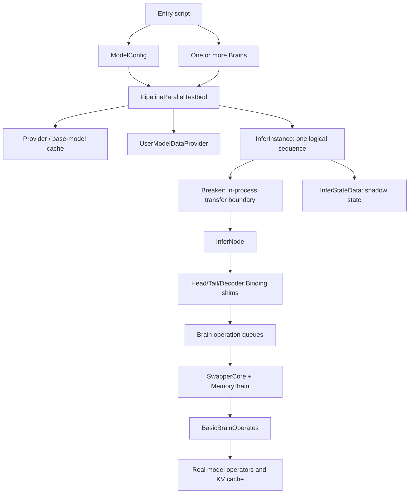
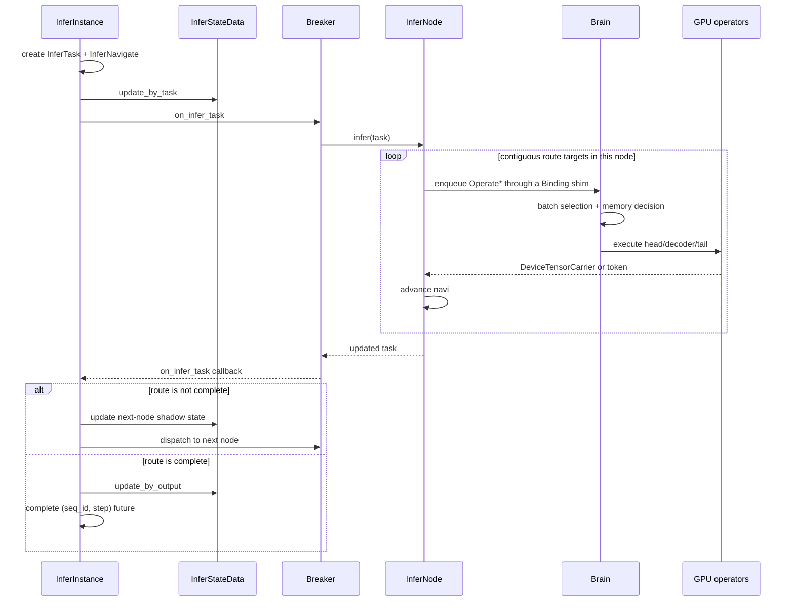

# Offline Design and Inference Execution Path

This document explains how `scripts/offline` reuses DROFELL's intra-node runtime in one process and how a prefill/decode request travels from a test entry point to model operators. The documented implementation corresponds to commit `c3404f4e31f86f6e963c1828c8964c7e188f6f54`.

## 1. Scope

Offline is not a simplified runner that bypasses the system layer and calls `model.forward()` directly. It retains:

- real `InferNode`, Binding shims, `Brain`, and `MemoryBrain` objects;
- KV-cache allocation, the GPU-memory digital twin, batch selection, and swap decisions;
- segmented head, decoder, and tail execution;
- LoRA/P-Tuning user-model loading;
- shadow state, block retrieval, and recovery state machines;
- eager decode and Marlin CUDA-graph decode.

It replaces inter-node communication. Dealers, Orbit, serialization, and network forwarding from a real deployment become in-process asynchronous callbacks through `Breaker`. Offline is therefore useful for:

- validating model operators, Bindings, scheduling, memory governance, PEFT, and recovery logic;
- measuring an intra-node inference path in one process and on one or more local devices;
- constructing pipeline groupings and failure-injection cases quickly.

It does not establish end-to-end distributed throughput, network overhead, cross-host reconstruction latency, or real-network failure semantics.

## 2. Components and ownership



| Object | Lifetime | Responsibility |
|---|---|---|
| `ModelConfig` | testbed | model, decoder backend, grouping, maximum length, and graph buckets |
| `PipelineParallelTestbed` | experiment | construct providers, load base shards and PEFT data, create instances |
| `Provider` | Brain | lazily create and cache head/decoder/tail dealer shims by base-model name |
| `Brain` | device/scheduling domain | receive operations, form batches, coordinate memory decisions, execute operators |
| `InferInstance` | sequence | token state, routing, result futures, nodes, and shadow state |
| `Breaker` | offline node boundary | replace network sends with local callbacks and suppress late messages after drop |
| `InferNode` | one local grouping in an instance | interpret `InferNavigate`, access Bindings, and advance the task |
| `InferStateData` | node grouping | mirror task progress and recoverable KV blocks, create recovery initialization material |
| `SeqComplex` | decoder request Binding | lengths, KV blocks/slots, sampling configuration, and PEFT representation |

One `InferInstance` is one sequence, not one batch. A `Brain` may batch several instances after they submit `generating_step()` concurrently.

## 3. Commonly confused names

Offline simultaneously uses base shards, route target names, Binding names, and sequence IDs. They are not interchangeable.

| Name | Example meaning | Purpose |
|---|---|---|
| `src` | `ModelDescribe` for a head, decoder range, or tail | select a shared base-model shard in `Provider` |
| `dst` | request-prefixed user-model/route name | target in `InferNavigate` and key in `InferNode` cache |
| base dealer Binding | shim returned by `Provider[src]` | share real base weights and the underlying decoder group among requests |
| request inference Binding | created from `src` for a specific `dst, seq_id` | own that sequence's KV, length, and PEFT state |
| `seq_id` | `seq-N` | identify the logical sequence of an `InferInstance` |

`groups` has type:

```python
List[List[Tuple[src_base_model_name, dst_route_name]]]
```

Each outer item is one node boundary; models in an inner list execute consecutively in one `InferNode`. Every `src` in a group must map to the same `Provider`. `src` selects shared base weights; `dst` selects the current request path.

## 4. Testbed initialization

`PipelineParallelTestbed.__init__` builds the environment in this order:

1. Set the decoder backend on each `Brain` and write graph configuration before loading decoders.
2. Create one `Provider` for each `Brain`.
3. Load the tokenizer.
4. Use `group_model_with_split` to split the model into a head, decoder groups, and a tail.
5. Assign contiguous decoder groups to Brains and trigger lazy base-shard loading through `Provider.__getitem__`.
6. Build `base_models_lookup: src -> provider_index`.

Marlin is the default decoder backend. `exllama` and `exllama_fuse` are explicit alternatives; CUDA graphs currently require Marlin.

`ModelConfig.group_fn` determines decoder-Binding granularity. The default is eight layers per group. The decode benchmark uses `lambda layers: [layers]`, placing all 32 Llama-2-7B layers in one decoder Binding so that one graph can cover the complete decoder.

`ModelConfig.__post_init__` mutates `base_model_config.max_seq_len` obtained from `ModelsLib`; limiting loaded layers also changes `num_decoders`. Account for this shared mutable state when reusing configuration objects or the model library in one process.

## 5. Creating an inference instance

`PipelineParallelTestbed.create_infer_instance()` creates an `InferInstance` and awaits `InferInstance.ainit()`. For each group, initialization:

1. builds an optional `InferHeadInit`, decoder `InferBindingInit` objects, and an optional `InferTailInit` from `src`;
2. slices LoRA/P-Tuning data to each decoder range and places it in decoder-Binding initialization arguments;
3. creates a `Breaker` and a real `InferNode`;
4. calls `InferNode.infer_init()` to create request-level Bindings;
5. creates `InferStateData` for the group;
6. builds the `dst -> (Breaker, InferStateData)` lookup.

`InferNode.infer_init()` ultimately submits creation operations through shims to the `Brain`:

- head and tail create request-level inference Bindings;
- decoder initialization creates `SeqComplex` with length, KV block/slot, and user-model handles;
- user-model data enters shared cache/KV management before a reference-counted handle binds it to the sequence;
- recovery initialization may restore existing KV blocks.

`create_infer_instance()` is therefore not pure Python metadata initialization: it can create device resources and load user-model data.

## 6. Common task state machine

Prefill and decode share `_infer_step()`:



Key fields:

- prefill `input` is the prompt-token-ID list and `step == 0`;
- decode `input` is the single token ID produced by the previous round;
- `InferNavigate.current` identifies the current `dst`;
- `InferNode` executes every target it still owns and returns only when the next target is outside the node;
- after route completion, `InferInstance` appends the token to its `SequenceCore` and evaluates stop conditions.

`Breaker` maintains a Brain barrier around `InferNode.infer()`. While waiting for Binding initialization or reorder conditions, `InferNode` temporarily releases the barrier so that the scheduling domain can progress. After a node is dropped, `Breaker` discards late resource and task callbacks.

## 7. Prefill path

```text
InferInstance.prefill
  -> InferInstance._infer_step(prompt_token_ids)
  -> Breaker.on_infer_task
  -> InferNode.infer
  -> HeadInferShim
  -> DecodersInferBindingShim
  -> Brain / BasicBrainOperates.do_prefill
  -> run_prefilling
  -> TailInferBindingShim
  -> sampling
```

Decoder prefill proceeds as follows:

1. Select contiguous prefill operations on the same underlying decoder Binding.
2. Call `SeqComplex.append_slot()` for every prompt token to allocate logical KV slots.
3. Collect KV blocks and user-model blocks used by the selected sequences.
4. Translate logical blocks/slots into the current physical layout through the cache engine.
5. Concatenate hidden states and positions and construct the P-Tuning cache provider or LoRA hook provider.
6. Run `DecodersGroup.multi_seqs_prefill_forward()` layer by layer, writing each layer's K/V into its slots.
7. Split outputs by sequence. If the next target is the tail, retain only the last prompt hidden state.
8. Update readonly blocks and sequence output counts; the tail then computes logits and samples the first token.

Prefill is always eager; current CUDA graphs cover decode only.

## 8. Eager decode path

One logical decode round begins with:

```python
await asyncio.gather(*(instance.generating_step() for instance in instances))
```

Each instance submits one operation. `SwapperCore` selects contiguous operations on the same underlying decoder Binding, up to `Brain.max_concurrency`. Real work is committed only after the candidate passes MemoryBrain simulation; if resources are insufficient, training contexts or KV blocks may be swapped first.

If a decode route contains an adjacent head, decoder group, and tail on the same Brain, `InferNode` creates only a composite plan. The shim attaches optional head/tail tasks to one `OperateDoGenerating`; they do not enter independent head/tail mailboxes. Operations remain separate across Brains, decoder groups, and every prefill path. See [Composite Decode Head/Tail Execution and CUDA Graphs](decode-composite-eager-design.md) for ownership and state boundaries.

The eager branch of `run_generating()`:

1. Executes zero or more embedded head groups batched by head Binding; operations without a head obtain hidden state from a carrier.
2. Computes `cached_lens = prompt_len + generated_len - 1`, positions, and context lengths.
3. Allocates one new KV slot per sequence.
4. Builds block tables, placing P-Tuning prefix blocks before ordinary sequence blocks.
5. Collects LoRA blocks and asks the cache engine to translate block tables and slots.
6. Concatenates hidden states and constructs the LoRA hook provider.
7. Runs quantized linear layers, rotary embeddings, paged attention, and MLPs layer by layer through `DecodersGroup.multi_seqs_generating_forward()`, updating KV cache.
8. Updates readonly blocks and output counts in `SeqComplex`.
9. Executes zero or more embedded tail groups batched by tail Binding. Operations without a tail return a hidden-state carrier. With no penalty, no logprobs, and temperature zero, the tail uses the batched greedy fast path.

When adjacent models remain in one local node, `DeviceTensorCarrier` may retain a batched device tensor and pass lazy per-sequence views without split, clone, or D2H. Crossing a group/provider boundary triggers the corresponding copy and synchronization through `cpu_in`/`cpu_out`. Changing `groups` therefore changes not only routing but also data movement and the scope of possible batches and graphs.

## 9. CUDA-graph decode path

Head, decoder, and tail each have independent graph runners owned by `BasicBrainOperates`. Adjacent head/decoder/tail shims on one Brain may additionally register fused variants. Current admission requires:

- graphs enabled;
- batch size within `1..max_concurrency` of the owning Brain;
- head/tail graphs used only for decode, while prefill remains eager;
- Marlin backend, context no greater than `Brain.max_seq_len`, and no LoRA in the decoder batch;
- greedy/no-logprobs sampling for a tail graph.

A fused graph requires identical optional head/tail structures and Bindings across the selected batch plus an exact captured variant. A three-stage graph cannot serve a two-stage request that lacks a tail. Heterogeneous structures, missing variants, LoRA, or unsupported sampling use staged fallback, while eligible standalone stage graphs may still replay.

Failed conditions fall back to eager without changing semantics. `DecodeGraphRunner.stats()` records replay and fallback classes.

Graph-cache keys are stage-specific:

```text
head:    (head binding name, batch size)
decoder/fused: (decoder binding, batch size, cache engine identity,
                optional head binding, optional tail binding)
tail:    (tail binding name, batch size)
```

Graph capture does not occur during the first decode. Initialization is staged as resources become available:

1. `capture_decode_graph()` enables graph-initialization policy before loading any model.
2. After head/tail loading, fixed buffers, eager warmup, and capture are created immediately for batches `1..max_concurrency`.
3. After each decoder Binding loads, its KV cache engine is created and temporary KV slots support warmup/capture for batches `1..max_concurrency`; the temporary slots are then released.
4. MemoryBrain performs the same temporary KV-block allocation, provider materialization, and release, so persistent scalable-cache buffers remain represented in the twin.
5. Long-lived requested bytes introduced by each CUDA graph enter the MemoryBrain runtime pool by stage.

During replay, each operation updates only its owned input buffers. The decoder verifies that cache-holder identity has not changed and waits for cache readiness. Head output is cloned after leaving a graph so that the next replay cannot overwrite a carrier still in the scheduling queue; token D2H for the tail remains outside the graph. No runner's `run()` method contains a capture branch: a missing initialization key is an error rather than an on-request capture.

With the default eight-layer decoder groups, every Binding has an independent graph and decoder groups do not merge. When head/tail and an edge decoder group share a Brain, edge fused variants are generated. When all 32 layers form one Binding with head and tail on the same Brain, only the complete head -> decoder -> tail fused variant is additionally retained; two-stage fused variants are omitted. All three standalone graphs remain for fallback.

## 10. LoRA and P-Tuning

`put_model_from_config()` loads a checkpoint on CPU, validates layer count and head geometry, converts it into inference data, and stores it in a `DeviceTensorCarrier`. Instance creation then slices the data by decoder range.

The PEFT representation inside a decoder Binding is:

- no PEFT: `None`;
- P-Tuning: `List[int]` of prefix KV-cache blocks;
- LoRA: `(LoraRenderConfig, List[int])` containing rendering configuration and weight blocks.

P-Tuning enters attention through dynamic block tables and context length, so current graphs support it. LoRA requires per-layer dynamic hook/weight selection, and the graph runner explicitly falls back with reason `lora`. LoRA inference is supported; LoRA plus CUDA graph is not.

## 11. Brain, batching, and the Memory Digital Twin

A Binding shim does not execute GPU work directly. It places `Operate*` data classes in Brain queues. `Brain.loop()` approximately prioritizes:

1. user-model, Binding, block, and other data/lifecycle operations;
2. executable work from head, decoder, and tail inference queues;
3. rollback-capable simulation of candidate batches in MemoryBrain;
4. real operation commit after restrictions pass, otherwise required swap or resource waiting.

The Memory Digital Twin is a scheduling decision model, not the CUDA allocator itself. `BasicBrainOperates` creates, executes, and releases modeled and real objects together and binds real results back into modeled lifetimes. Divergence can produce incorrect admission or swap decisions, so OOM diagnosis should inspect:

- cache-engine and real-tensor lifecycles;
- corresponding object and pool lifecycles in MemoryBrain;
- registration and release of long-lived requested bytes from graph capture.

Batch formation is also constrained by queue order: the scheduler selects contiguous operations for the same underlying Binding. Increasing `max_concurrency` alone does not guarantee that arbitrary concurrent requests will merge.

## 12. Shadow state and recovery

When `InferTestConfig.recover` is enabled, configured decode steps call `InferInstance.recover()`:

1. The old `Breaker` closes inbound messages and marks the old node dropped.
2. `InferStateData.gen_init_cfg()` creates new initialization configuration and replay tasks.
3. New `InferNode` objects are created on the original or split grouping.
4. Decoder Bindings, length state, and available KV blocks are restored.
5. Additional tasks replay before the original result future continues.

`block_retrieve` only controls whether the new `InferNode` registers a KV-block return callback on decoder Bindings. Whether recovery uses KV depends on `InferStateData.blocks` containing a contiguous checkpoint from block 0 across every decoder Binding in the node. `block_retrieve=True` therefore does not guarantee a KV-based recovery; before the first complete block returns, recovery still uses the no-KV fallback.

### 12.1 No available KV: merged prefill

When `_block_kv_cache_len == 0`, new decoder Bindings initialize with `init_step=0`, `output_count=0`, and `allocate_slots=False`. `merged_prompt()` combines the original prompt with retained decode inputs but intentionally leaves the final decode task:

```text
original: prefill(prompt), decode(1, x1), ..., decode(n, xn)
recovery: prefill(prompt + x1 + ... + x[n-1]), decode(n, xn)
```

The merged prefill task receives step `n-1`. Unlike ordinary prefill, which occurs only at step 0, it starts with a fresh Binding reorder controller at step 0 and advances that controller directly to step `n`; the final decode then becomes executable. Retaining the last decode reconstructs the latest KV and output at the recovery boundary while covering uncertainty about whether the failed node completed that task. The path is therefore “coalesce through the penultimate input, then replay the final decode,” not simply “compress all history into one prefill.”

### 12.2 Available KV: checkpoint injection and chunked decode replay

Let prompt length be `P`, contiguous checkpoint-block count `B`, and block size `S` (currently 32). The checkpoint covers `K` KV slots and defines recovery frontier `g`:

```text
K = B * S
g = K - P + 1
```

New decoder Bindings use `init_step=g`, `output_count=g`, and `allocate_slots=True`. Since `SequenceLengthData.num_slots = P + g - 1 = K`, initialization allocates exactly `K` logical slots. `init_blocks` converts the shadow's block-major representation into the layer-major format required by decoder initialization, and `InferNode.infer_init()` writes it with `put_blocks()`.

Only inputs at and after step `g` not covered by the checkpoint are replayed, preserving paged-attention decode semantics without rerunning the prompt. The default `recovery_replay="chunk"` coalesces contiguous input into one recovery task; compatibility mode `"sequential"` retains one replay task per step. Coalescing lives in shared `InferStateData`. The offline testbed selects the mode and supplies complete confirmed output history; Agent and Backbone online recovery call the same implementation.

A chunk is not causal prefill. The head embeds every known token once. Each decoder layer represents each chunk token as one decode-batch row. Rows share the final restored block table but use increasing context lengths:

```text
position[j]    = K + j
context_len[j] = ptuning_slots + K + j + 1
slot[j]        = K + j
```

The layer first writes the chunk's K/V into contiguous slots; paged attention masks future rows through per-row context lengths. Row `j` sees the checkpoint and chunk rows `[0, j]`, while the entire chunk calls `multi_seqs_generating_forward()` only once. The tail does not recompute norm, LM head, or sampling for confirmed historical rows; it records output token IDs retained in shadow state and advances the controller. Recovery computation still grows with uncovered input, but Python scheduler/shim/decoder calls fall from once per token to once per chunk.

At intermediate shadow states, a task is expanded back into single-step history so that later recovery can slice at a new KV-checkpoint boundary. Ordinary prefill and recovery chunks use separate scheduling groups and cannot enter the same batch.

KV is not returned on every step. Before decode, `InferNode` checks:

- `(slots_count - 8) % BLOCK_SIZE == 0`;
- `slots_count - 8` has passed the initial/prefill slot count of this Binding;
- only new complete blocks in `ready_blocks = floor(slots_count / BLOCK_SIZE)` are selected.

A complete block therefore receives at least eight later slots before the return check. Shadow state additionally requires all decoder groups for one block index and contiguous indexes before promoting data from `pending_blocks` to `blocks`. Each checkpoint-frontier promotion removes old decode tasks already covered by KV from `_generatings`. Recovery before the next promotion replays more decode tasks from the same checkpoint frontier.

### 12.3 Scheduling and duplicate results

Recovery occurs after `generating_step()` increments the current step but before dispatch of that task. The old `Breaker` first rejects subsequent inbound callbacks and marks the node dropped. New-node initialization and replay are submitted asynchronously; the current ordinary task then also arrives at the new node. The new Binding's reorder controller makes it wait until replay catches up. Duplicate tail output from replay is discarded by `TailData.update_by_output()` according to recorded output count, while the original current-step result future remains valid.

### 12.4 Coverage of `infer_correctness.py`

The script runs warmup, a `block_retrieve=False` baseline, a no-recovery `block_retrieve=True` baseline, and the configured correctness case. CLI and benchmark share one recovery argument format:

```bash
--block-retrieve --recover 20 40 80:split
```

Without `--block-retrieve`, KV is not returned. Without `--recover`, no recovery occurs. The script asserts identical token IDs across the three runs and writes tokens, completion times, and `InferInstance.recovery_records` to schema-version-2 JSON. It fails if a requested recovery never triggers, for example because of early EOS.

For each recovered node, `recovery_records` stores checkpoint-block count, Binding initialization step, and replay-task type (`prefill`, `decode`, or `decode_chunk`), step range, and count. When a KV checkpoint is injected, the core also asserts that replay contains no prefill. `--recovery-replay sequential|chunk` supports a direct A/B comparison; `chunk` is the default.

In one complete GPU run using Llama-2-7B GPTQ/P-Tuning, the prompt length was 38. Multiple-recovery runs with block retrieval observed:

| Recovery step | Committed blocks | Binding `init_step` | Default replay form |
|---:|---:|---:|---|
| 20 | 0 | 0 | merged prefill (step 18) + decode (step 19) |
| 40 | 2 | 27 | decode chunk 27..39 |
| 60 | 2 | 27 | decode chunk 27..59 |
| 80 | 2 or 3 | 27 or 59 | one chunk from latest complete checkpoint through 79 |
| 100 | 4 | 91 | decode chunk 91..99 |
| 120 | 4 | 91 | decode chunk 91..119 |

Block return is asynchronous, so the number promoted into shadow `blocks` immediately before step 80 varied with scheduling. Recovery depends only on the contiguous checkpoint committed at that moment, not a fixed block count.

The corrected runner also validated bounded cases:

- `--block-retrieve --recover 40 --max-tokens 64 --ignore-eos`: two blocks at recovery, all four decoder Bindings initialized at step 27, replay 27..39 coalesced into one 13-item `decode_chunk`, and identical 64-token output across all three runs.
- With `--recover 40:split`, the head node submitted decode 27..39 and navigation crossed four decoder nodes, each initialized at step 27 from the KV checkpoint. Each node called the decoder once for the chunk, with identical output.
- `--recover 20 --max-tokens 32 --ignore-eos`: no KV, all four Bindings initialized at step 0, replay used merged prefill at step 18 plus decode at step 19, with identical output.
- Step 40 run with `--recovery-replay sequential` and default `chunk`: both matched the 64-token no-recovery baseline. In this single RTX 3090 offline configuration, the adjacent-token completion gap at recovery decreased from 145.955 ms to 29.976 ms (about 4.87x, or 79.5%). This is not an online end-to-end recovery claim.
- `--groups 2`, repeated recovery at steps 40/60, five recoveries with natural EOS, and step-40 split all passed token-consistency checks, covering cross-node carriers, repeated recovery, and varying tail lengths.

These observations establish behavior in the stated offline environment, not real-network failure semantics. Offline does not model network disconnect timing, message-reorder probability, transmission bandwidth, or remote-process death.

## 13. Lifecycle

Explicitly call at the end of a run:

```python
instance.remove()
```

This removes request-level nodes and Bindings and releases user-model handles and sequence cache. Do not rely on `__del__` timing. `Provider` caches shared base-model shims, so removing one instance normally leaves base weights loaded; provider cleanup occurs when the testbed is destroyed.

Graphs belong to shared decoder base Bindings and may be reused across request instances. Removing a decoder Binding must also remove its graphs and registered graph runtime memory from MemoryBrain.

## 14. Interpreting performance data

The offline decode benchmark excludes model loading, instance creation, prefill, and decode warmup. Its measured interval includes:

```text
per-round task submission -> offline routing -> Brain scheduling/batching
-> decoder -> tail/sampling -> token return and completion of the logical
round for every sequence
```

It is suitable for same-device comparisons of eager versus graph, backend choice, and batch scaling. It excludes Orbit, real RPC, serialization, and cross-host tensor transfer and is not online end-to-end throughput.

## 15. Suggested decode-debugging order

1. Check `ModelConfig`: backend, `group_fn`, maximum concurrency, and graph buckets.
2. Check `groups`: every `src -> dst` and provider boundary.
3. Check `InferTask.navi.current` and step to find the stalled target.
4. Check whether requests enter the same underlying decoder Binding and can form one batch.
5. Check `DecodeGraphRunner.stats()` to distinguish replay from fallback.
6. Check `DeviceTensorCarrier` device placement and `cpu_in`/`cpu_out`.
7. Check `SeqComplex` length, slots, block table, and PEFT representation.
8. For OOM or swap issues, compare real cache lifecycles with MemoryBrain modeled lifetimes.
9. For recovery issues, compare task, output, and block updates in `InferStateData`.

## 16. Source-reading order

1. `scripts/offline/testbed/model_config.py`
2. `scripts/offline/testbed/pipeline_parallel_testbed.py`
3. `scripts/offline/testbed/infer_instance.py`
4. `node/compute_node/infer_node.py`
5. `dealers/common/provider.py`
6. `dealers/common/brain.py`
7. `dealers/memory_schedule/brain.py`
8. `dealers/memory_schedule/swapper_core.py`
9. `dealers/real_basic/basic_operate.py`
10. `dealers/real_basic/infer_binding.py`
11. `dealers/real_basic/decode_graph.py`
12. `dealers/real_basic/memory.py`

Runnable entry points:

- `scripts/offline/basic/infer_basic.py`: basic inference, LoRA/P-Tuning, graph, and recovery cases;
- `scripts/offline/basic/infer_correctness.py`: P-Tuning and recovery-output consistency;
- `scripts/offline/benchmark/inference/benchmark.py --measurement decode`: decode-only performance;
- `scripts/offline/testbed/README.md`: testbed components and limitations;
- `scripts/base/infer.py`: a more direct single-model runner for operator-level eager/graph behavior; it does not traverse the offline `InferNode`/Brain scheduling chain.
